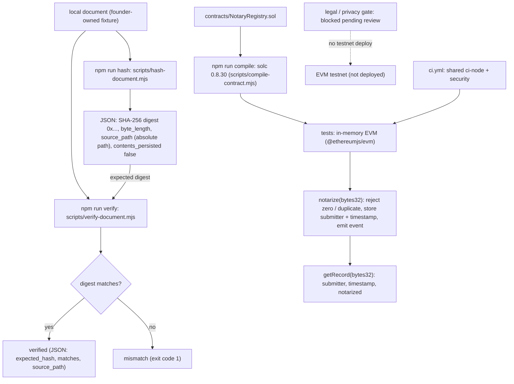
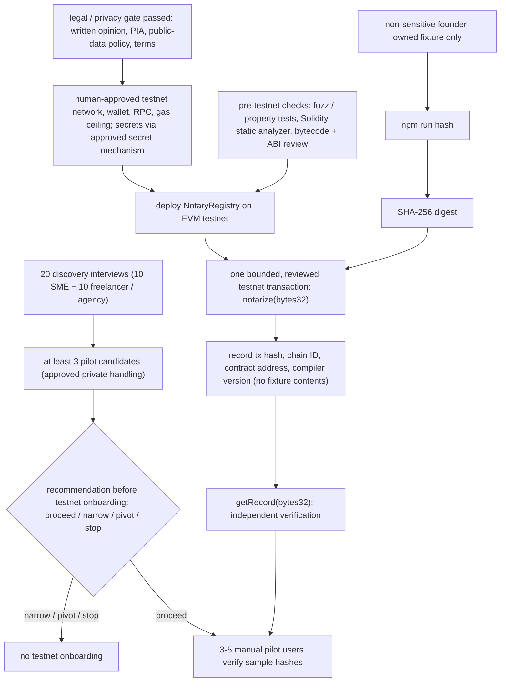

# 01 — Business process (As-Is / To-Be)

ProvenChain คือ MVP core สำหรับพิสูจน์ความถูกต้องของเอกสาร: CLI hash เอกสารแบบ SHA-256 บนเครื่อง และ smart contract `NotaryRegistry` เก็บเฉพาะ hash, ผู้ส่ง และเวลา block บน EVM chain โดยไม่เก็บเนื้อหาเอกสาร วันนี้ทำงานแบบ local / ทดสอบ offline เท่านั้น ยังไม่ deploy ขึ้น testnet

Last reviewed: 2026-11-28 · commit `ac6df90`

## As-Is (จากโค้ดวันนี้)

Sources: `scripts/hash-document.mjs`, `scripts/verify-document.mjs`, `scripts/compile-contract.mjs`, `src/document-hash.mjs`, `contracts/NotaryRegistry.sol`, `tests/notary-registry-evm.test.mjs`, `.github/workflows/ci.yml`, `README.md`, `docs/LEGAL-PRIVACY-GATE.md`

ข้อเท็จจริงจากโค้ด: ไม่มี script deploy, wallet, RPC, API, database หรือ frontend ใน repo; `verify` เทียบ digest บนเครื่องเท่านั้น ไม่ได้อ่าน `getRecord` จาก chain

JSON ที่ `hash` และ `verify` พิมพ์ออกมามี `source_path` เป็นพาธเต็มของไฟล์ (อาจมีชื่อผู้ใช้และชื่อไฟล์): `contents_persisted: false` หมายถึงไม่เก็บเนื้อหา ไม่ได้หมายถึงไม่เปิดเผย metadata ก่อนแนบ JSON เป็นหลักฐานต้องตัดหรือปิด `source_path`

## To-Be (`PRODUCT.md` §Exit evidence for the next gate; `docs/ARCHITECTURE-DECISION.md`; `docs/LEGAL-PRIVACY-GATE.md`; `docs/DISCOVERY-PLAN.md`)

Sources: `PRODUCT.md` §Exit evidence for the next gate, `docs/ARCHITECTURE-DECISION.md` §Decision, `docs/LEGAL-PRIVACY-GATE.md` §Pre-testnet acceptance gate, `docs/TEST-STRATEGY.md` §Required before testnet, `docs/DISCOVERY-PLAN.md` §Exit criteria, `docs/INTERVIEW-EVIDENCE-REGISTER.md`, `README.md` §Testnet boundary

ลำดับ: ตัดสินใจจาก discovery (ต้องมีผู้สมัคร pilot อย่างน้อย 3 คน) ก่อนรับผู้ใช้เข้า testnet; ธุรกรรม testnet ส่งได้หลัง gate ผ่าน, owner อนุมัติ network / wallet / RPC / gas, ตรวจสัญญาทางเทคนิคครบ และ deploy แล้วเท่านั้น โดยใช้ไฟล์ทดสอบที่ไม่อ่อนไหวและเป็นของ founder และ inject wallet / RPC ผ่านกลไก secret ที่อนุมัติ (ห้ามใส่ private key ใน repo หรือ command line)

## Gap

| ID | As-Is → To-Be | Status | Owner | Evidence |
|---|---|---|---|---|
| G1 | ไม่มีความเห็นจากผู้เชี่ยวชาญด้านกฎหมาย / privacy → written preliminary opinion, PIA/DPIA, นโยบายข้อมูลสาธารณะ, terms | blocked | owner | `docs/LEGAL-PRIVACY-GATE.md` §Pre-testnet acceptance gate (Decision: blocked pending review) |
| G2 | ยังไม่เลือก network, wallet, RPC และงบ gas → owner อนุมัติ testnet network และ gas ceiling | blocked | owner | `docs/ARCHITECTURE-DECISION.md` §Explicit non-decisions; gate row Network budget |
| G3 | ไม่มี deploy และ testnet transaction → contract บน testnet + reviewed transaction (deploy ไม่อัตโนมัติจนกว่า gate ผ่าน) | blocked | claude | `README.md` §Testnet boundary; `PRODUCT.md` §Exit evidence |
| G4 | `verify` เทียบ digest บนเครื่องเท่านั้น → เพิ่ม flag `--onchain` (opt-in) ที่ตรวจกับ `getRecord` บน chain; ค่าเริ่มต้นยังตรวจบนเครื่อง (owner ตัดสิน 2026-11-28: เพิ่ม) | todo | claude | `scripts/verify-document.mjs`; `PRODUCT.md` §Demo promise |
| G5 | discovery interview 0 จาก 20 → 10 SME + 10 freelancer / agency พร้อมผลสรุปแบบ aggregate | todo | owner | `docs/INTERVIEW-EVIDENCE-REGISTER.md` (Interviews completed 0); `docs/DISCOVERY-PLAN.md` |
| G6 | ไม่มี pilot candidate / pilot user → อย่างน้อย 3 pilot candidates ก่อนตัดสินใจ, แล้ว 3–5 manual pilot users ตรวจ sample hash บน testnet หลัง recommendation = proceed | todo | owner | `docs/DISCOVERY-PLAN.md` §Exit criteria; `PRODUCT.md` §Exit evidence |
| G7 | การตัดสินใจ proceed / narrow / pivot / stop ยังรอหลักฐาน → owner บันทึก recommendation ก่อนรับผู้ใช้เข้า testnet; owner ตัดสิน 2026-11-28: ยังไม่ตัดสินจนกว่าจะมีหลักฐานจากผู้ใช้; ทบทวน 2026-12-31 | decide | owner | `docs/DISCOVERY-PLAN.md` (Decision: pending evidence) |
| G8 | มีแค่ EVM behaviour tests → fuzz / property tests สำหรับ `bytes32` ที่ไม่เป็นศูนย์, Solidity static analyzer, ทบทวน bytecode / ABI เทียบ source ก่อน deploy | todo | claude | `docs/TEST-STRATEGY.md` §Required before testnet; `tests/` (ไม่มี fuzz / static analysis) |
| G9 | To-Be ให้ deploy หลังอนุมัติ network, wallet, RPC, gas แต่ยังขาดการอนุมัติการเผยแพร่ผ่าน explorer และการเก็บ artifacts → เพิ่มขั้นนี้ (Codex review 2026-11-28, จดไว้แทนการวาดใหม่ตามที่ owner สั่ง) | todo | claude | `docs/SECURITY-AND-PRIVACY.md:28-33` |
| G10 | ทาง `proceed` เปิดเมื่อสัมภาษณ์ครบ 20 คนและมีผู้สมัคร pilot 3 คน โดยไม่ตรวจเกณฑ์ปิด discovery ข้ออื่น → เพิ่มการตรวจเกณฑ์ครบ (Codex review 2026-11-28, จดไว้แทนการวาดใหม่ตามที่ owner สั่ง) | todo | claude | `docs/INTERVIEW-EVIDENCE-REGISTER.md:78-86` |
| G11 | บันทึกหลักฐานจบก่อนเรียก `getRecord` และไปถึง pilot ได้แม้ได้ `notarized: false` → บันทึกผลตรวจบน testnet และต้องผ่านก่อน pilot (Codex review 2026-11-28, จดไว้แทนการวาดใหม่ตามที่ owner สั่ง) | todo | claude | `docs/TEST-STRATEGY.md:36-38` |

## Open questions

- gate control "Secret boundary" (wallet / RPC ผ่านกลไก secret ที่อนุมัติ) จะใช้ Infisical หรือไม่ ยังไม่มีเอกสารระบุ
